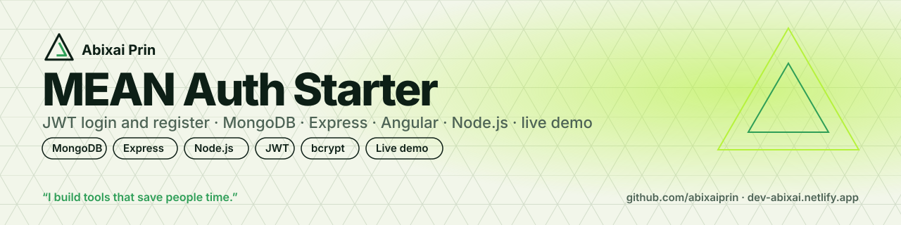
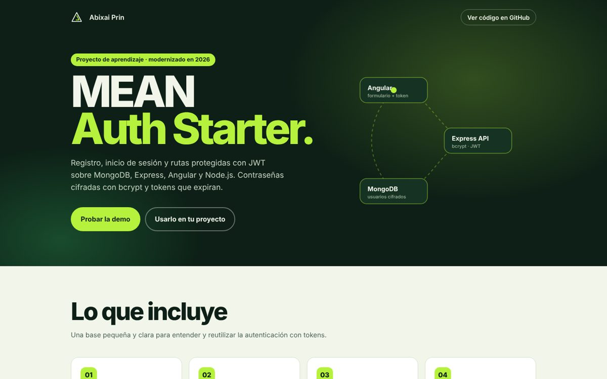
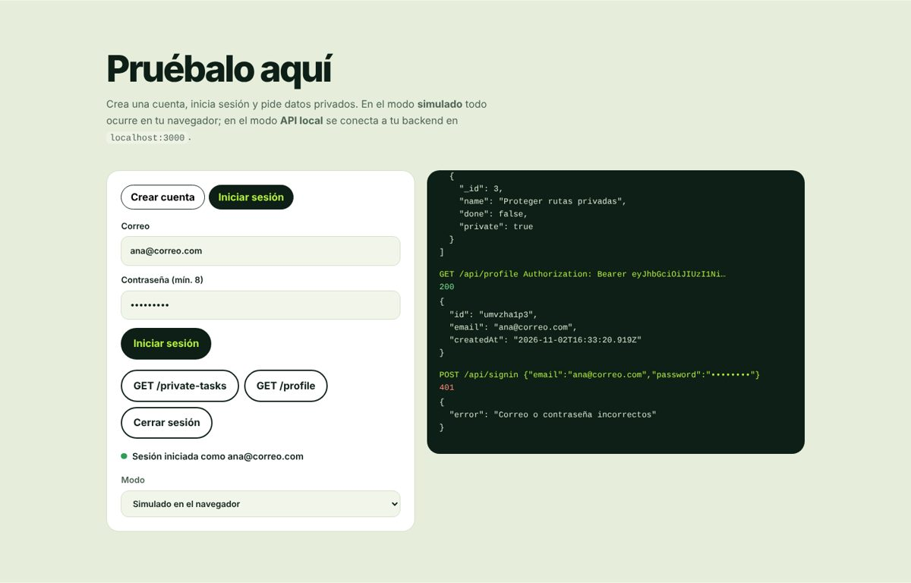
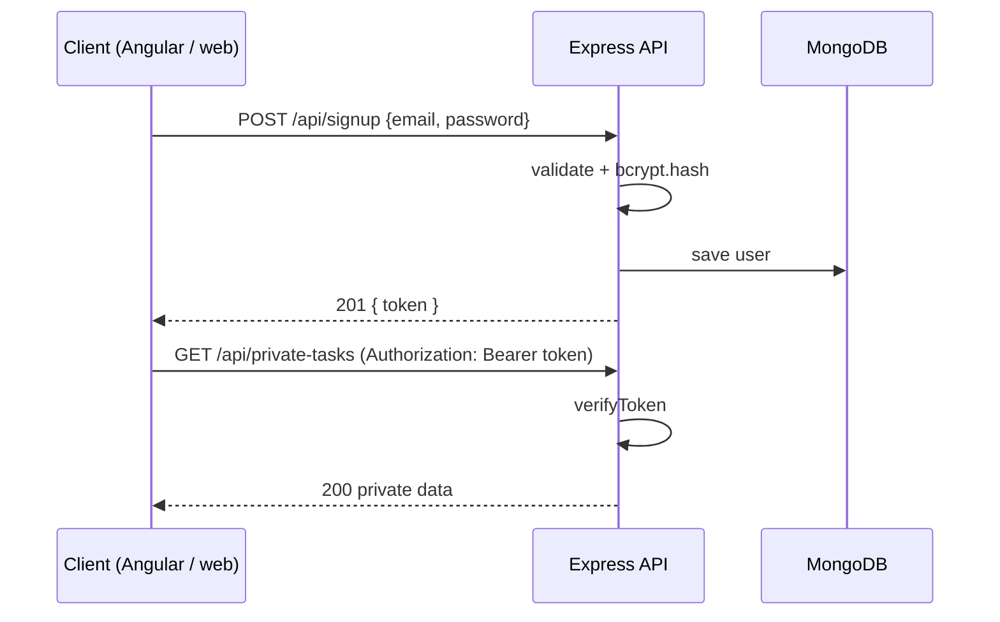

<p align="center"></p>

# MEAN Auth Starter

**Sign up, sign in and protected routes with JWT on the MEAN stack.**
Started in 2020 as a learning project and modernized in 2026: hashed passwords, expiring tokens, validation and clear errors.

   

### 👉 [Try the live demo](https://abixaiprin.github.io/mean-project/)

<p align="center"> </p>

## What you get
| | |
|---|---|
| 🔐 **Auth endpoints** | `POST /api/signup` and `POST /api/signin` with email and password validation |
| 🧂 **Hashed passwords** | bcrypt (12 rounds); passwords are never stored or returned in plain text |
| ⏱️ **Expiring JWT** | secret and expiry from `.env` (`JWT_SECRET`, `JWT_EXPIRES_IN`) |
| 🛡️ **Protected routes** | `verifyToken` middleware with clear messages for missing, invalid or expired tokens |
| 🧪 **Interactive demo** | try the whole flow in the browser, or point it at your local API |

## How it works


## Quick start
```bash
git clone https://github.com/abixaiprin/mean-project
cd mean-project/backend
npm install
cp .env.example .env      # set MONGODB_URI and JWT_SECRET
npm run dev               # http://localhost:3000/api
```
Then open the [live demo](https://abixaiprin.github.io/mean-project/), switch **Mode → Local API** and test against your own server.

## Endpoints
| Method | Route | Auth | Description |
|---|---|---|---|
| POST | `/api/signup` | — | Create the user and return a token (201) |
| POST | `/api/signin` | — | Check credentials and return a token |
| GET | `/api/tasks` | — | Public sample data |
| GET | `/api/private-tasks` | Bearer | Private sample data |
| GET | `/api/profile` | Bearer | Email and sign-up date of the user |

## Project structure
```
backend/
  src/
    config.js            # reads .env
    database.js          # MongoDB connection
    index.js             # Express app, CORS, error handling
    middleware/auth.js   # verifyToken
    models/user.js       # schema + bcrypt hooks
    routes/index.js      # auth and sample routes
docs/index.html          # live demo (GitHub Pages)
```

## Make it yours
- Change the sample routes in `routes/index.js` for your own resources.
- Add roles to `models/user.js` (`role: 'admin' | 'user'`) and check them in a middleware.
- For production add rate limiting, HTTPS and tests.

## Before and after
| 2020 | 2026 |
|---|---|
| Plain-text passwords | bcrypt hashing |
| Hard-coded JWT secret | `.env` + expiry |
| No validation | Email and password checks, consistent JSON errors |
| `node_modules` committed | Clean repo with `.gitignore` |

## Author
**Abixai Prin** — Full Stack developer since 2017 · [dev-abixai.netlify.app](https://dev-abixai.netlify.app) · [GitHub](https://github.com/abixaiprin)

⭐ Star it if it helped you understand JWT · ☕ [Buy me a coffee on Ko-fi](https://ko-fi.com/abixaiprin)

## License
MIT © 2020–2026 Abixai Prin

---
<p align="center"><sub>Made in Caracas by <b>Abixai Prin</b> · <i>I build tools that save people time.</i></sub></p>
